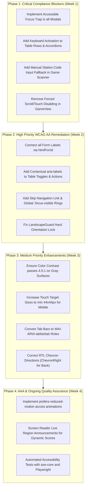

# Comprehensive Accessibility (a11y) Audit: apps/main

**Date:** November 2026  
**Auditor:** Accessibility Auditor (`@a11y`)  
**Target Scope:** `apps/main` (All Views, Components, Modals, Navigation, Game Engine, `index.html`, and CSS)  
**Standards Evaluated:** 
- **WCAG 2.1 Level AA & Level AAA** (Web Content Accessibility Guidelines)
- **WAI-ARIA 1.2** Authoring Practices Guide (APG)
- **IS 5568 / ת"י 5568** (Israeli Web Accessibility Standard for Educational Portals)
- **WCAG 2.2** Target Size and Focus Appearance Previews

---

## 1. Executive Summary

An exhaustive accessibility evaluation was performed across the `apps/main` React application. The portal serves as the primary management, grading, attendance, and activity hub for Israeli leadership course cadets, instructors, and administrative staff, alongside an interactive QR-based field game (`GameView`).

While the application features clean Google-inspired Material styling and properly declares Hebrew language and RTL layout in `index.html` (`<html lang="he" dir="rtl">`), it exhibits **systemic accessibility barriers** across modal focus management, form label associations, screen reader announcements, interactive semantics, and orientation/motion constraints.

### 1.1 Accessibility Scorecard & Key Metrics

| Metric | Measurement / Audit Finding | Compliance Status |
|---|---|---|
| **Total Source Files Audited** | 47 files (`.html`, `.css`, `.tsx`, `.ts`) | Full Scope Coverage |
| **Overall WCAG 2.1 AA Compliance** | **52% (Non-Compliant)** | **Fails Legal Compliance Threshold** |
| **Total Violations Cataloged** | **34 Distinct Issues** (6 Critical, 12 High, 11 Medium, 5 Low) | Actionable remediation required |
| **Modal Dialog Focus Management** | 0 of 8 Modals implement focus traps or focus restoration | **Critical Barrier** |
| **Form Controls with Accessible Names** | ~35% of inputs rely purely on placeholder or orphan `<label>` | **High Barrier** |
| **Interactive Keyboard Support** | Multiple custom `<div>` clickables lack keyboard activation | **Critical Barrier** |
| **Color Contrast (Text AA 4.5:1)** | Fails on secondary gray `#5f6368` on `#f8f9fa` (4.45:1) & amber tags | **Medium Barrier** |
| **Target Size (WCAG 2.2 SC 2.5.8)** | Icon-only buttons with `< 24x24px` interactive touch targets | **High Barrier** |
| **Game View Assistive Usability** | Hard orientation lock + No manual code entry fallback for camera | **Critical Barrier** |

---

## 2. Accessibility Findings Matrix

| ID | File & Line Location | WCAG 2.1 SC | Severity | Category | Summary of Issue |
|---|---|---|---|---|---|
| **A11Y-01** | `index.html` / `App.tsx` (L298) | **2.4.1 (AA)** Bypass Blocks | **High** | Keyboard Navigation | No skip navigation link (`<a href="#main-content">`) to allow keyboard users to bypass top bars. |
| **A11Y-02** | `src/index.css` (Global) | **2.4.7 (AA)** Focus Visible | **High** | Visual Focus | No global `:focus-visible` ring. Widespread use of `outline-none` removes default focus indicators without replacement. |
| **A11Y-03** | `src/index.css` (Global) | **2.3.3 (AAA)** Motion | **Low** | Motion & Vestibular | Missing `@media (prefers-reduced-motion: reduce)` rules for spinners, modal animations, and pulse effects. |
| **A11Y-04** | `src/components/ui/Modal.tsx` (L23–L58) | **2.1.2 (A)** No Keyboard Trap<br>**2.4.3 (A)** Focus Order | **Critical** | Dialogs / Modals | No focus trap, no focus restoration to trigger element, and Escape key is disabled for confirm dialogs (`!modal.isConfirm`). |
| **A11Y-05** | Multiple Modals (`EventBuilderModal`, `ExamBuilderModal`, `GradeEntryModal`, `UserFormModal`, `StudentProfileModal`) | **2.1.1 (A)** Keyboard<br>**2.4.3 (A)** Focus Order | **Critical** | Dialogs / Modals | Custom dialog overlays completely lack `keydown` listeners for Escape and do not trap Tab focus inside the dialog. |
| **A11Y-06** | `src/components/events/EventBuilderModal.tsx` (L82–L148) | **1.3.1 (A)** Info & Relationships<br>**3.3.2 (A)** Labels | **High** | Forms & Inputs | Labels lack `htmlFor` attributes and form inputs/selects/textareas lack corresponding `id` attributes. |
| **A11Y-07** | `src/components/exams/ExamBuilderModal.tsx` (L149–L178) | **3.3.2 (A)** Labels<br>**4.1.2 (A)** Name, Role, Value | **High** | Forms & Inputs | Dynamically generated category inputs (name and maxScore) have no `<label>` or `aria-label`. Remove button is unnamed icon. |
| **A11Y-08** | `src/components/exams/GradeEntryModal.tsx` (L102–L121) | **3.3.2 (A)** Labels<br>**4.1.2 (A)** Name, Role, Value | **High** | Forms & Inputs | Category score inputs in loop have no programmatic name or label connecting them to the category. |
| **A11Y-09** | `src/components/users/UserFormModal.tsx` (L177–L236) | **4.1.2 (A)** Name, Role, Value<br>**2.1.1 (A)** Keyboard | **High** | Combobox / Custom UI | School search dropdown acts as a pseudo-combobox without ARIA combobox pattern and lacks keyboard arrow navigation. |
| **A11Y-10** | `src/components/users/UserFormModal.tsx` (L278–L296) | **4.1.2 (A)** Name, Role, Value | **Medium** | Form Controls | Medical/characteristic tag buttons act as toggle switches but lack `aria-pressed`. |
| **A11Y-11** | `src/components/events/AttendanceReportTable.tsx` (L175–L214) | **4.1.2 (A)** Name, Role, Value<br>**1.3.1 (A)** Info & Relationships | **High** | Tables & Controls | Toggle buttons (V, Dot, X) have generic labels ("נכח", "חסר", "נעדר") that omit student name context and lack `aria-pressed`. |
| **A11Y-12** | `src/components/events/AttendanceReportTable.tsx` (L143–L150) | **3.3.2 (A)** Labels or Instructions | **Medium** | Forms & Inputs | Search input uses `placeholder="חיפוש חניך לפי שם..."` with no `<label>` or `aria-label`. |
| **A11Y-13** | `src/components/users/UserManagementTable.tsx` (L59–L109) | **3.3.2 (A)** Labels or Instructions | **Medium** | Forms & Inputs | Search bar and three filter dropdowns (School, Role, Tag) lack `<label>` or `aria-label`. |
| **A11Y-14** | `src/components/users/UserManagementTable.tsx` (L217–L224) | **4.1.2 (A)** Name, Role, Value | **Medium** | Controls | Edit user button has generic `title="ערוך משתמש"` without an accessible name specific to the user. |
| **A11Y-15** | `src/views/AdminView.tsx` (L629) | **2.1.1 (A)** Keyboard<br>**4.1.2 (A)** Name, Role, Value | **Critical** | Keyboard Navigation | Report table `<tr>` rows have `onClick` to open student profile but are not keyboard focusable (`tabIndex`) or activatable via Space/Enter. |
| **A11Y-16** | `src/views/AdminView.tsx` (L268–L274) / `LoginView.tsx` (L110–L127) | **4.1.2 (A)** Name, Role, Value | **Medium** | Tab Navigation | View and login mode switchers are styled as tabs but lack `role="tablist"`, `role="tab"`, and `aria-selected`. |
| **A11Y-17** | `src/views/AdminView.tsx` (L349–L355) | **2.1.1 (A)** Keyboard<br>**3.3.4 (AA)** Error Prevention | **Medium** | Alert Modals | Deletion of events uses blocking browser `window.confirm()` instead of the accessible application confirmation dialog. |
| **A11Y-18** | `src/views/InstructorView.tsx` (L309–L331) | **2.1.1 (A)** Keyboard<br>**4.1.2 (A)** Name, Role, Value | **Critical** | Accordion / Controls | Student card accordion toggle is a `<div>` with `onClick`. Keyboard users cannot tab to it or expand it. |
| **A11Y-19** | `src/views/InstructorView.tsx` (L288–L296) | **3.3.2 (A)** Labels or Instructions | **Medium** | Forms & Inputs | Search input lacks programmatic label (`aria-label="חיפוש חניך במחלקה"`). |
| **A11Y-20** | `src/views/StudentView.tsx` (L105) / `AdminView.tsx` (L215) / `LoginView.tsx` (L103) | **1.1.1 (A)** Non-text Content | **Low** | Images & Graphics | Application logo images have generic `alt="Logo"` instead of descriptive Hebrew text ("לוגו קורס הנהגה 2027"). |
| **A11Y-21** | `src/components/bulletin/BulletinBoardBanner.tsx` (L161–L171) | **3.2.5 (AAA)** Change on Request<br>**2.4.4 (A)** Link Purpose | **Low** | External Links | Action link chips open external tabs (`target="_blank"`) without text or screen reader warning of new window opening. |
| **A11Y-22** | `src/components/bulletin/BulletinBoardBanner.tsx` (L177–L203) | **2.1.1 (A)** Keyboard<br>**2.4.3 (A)** Focus Order | **High** | Modal Lightbox | Lightbox image preview modal lacks Escape key handling, focus trapping, and an accessible dialog name. |
| **A11Y-23** | `src/components/bulletin/BulletinEditorModal.tsx` (L514–L520) | **4.1.2 (A)** Name, Role, Value | **High** | Rich Text Editor | WYSIWYG editor is a raw `contentEditable` div without `role="textbox"`, `aria-multiline="true"`, or programmatic label. |
| **A11Y-24** | `src/components/navigation/MobileBottomNav.tsx` (L40–L64) | **2.5.8 (AA)** Target Size | **Medium** | Touch Targets | Mobile bottom navigation items have total height of ~38px, falling short of recommended 44x44px touch targets. |
| **A11Y-25** | `src/components/ui/Toast.tsx` (L9–L27) | **4.1.3 (AA)** Status Messages | **Low** | Dynamic Announcements | Toast always uses `aria-live="polite"`. Error toasts should utilize `aria-live="assertive"` for immediate screen reader alert. |
| **A11Y-26** | `src/views/game/GameView.tsx` (L39–L48) | **2.1.1 (A)** Keyboard<br>**1.4.10 (AA)** Reflow | **Critical** | Touch & Scrolling | Game engine locks page scrolling via `document.body.style.overflow = 'hidden'` and `touchAction = 'manipulation'`, disabling browser zoom and assistive reflow. |
| **A11Y-27** | `src/views/game/components/LandscapeGuard.tsx` (L28–L55) | **1.3.4 (AA)** Orientation | **High** | Device Orientation | Blocks portrait orientation entirely with an overlay, requiring users to rotate or find an obscure bypass button. |
| **A11Y-28** | `src/views/game/components/NavigationHud.tsx` (L93–L96) | **4.1.3 (AA)** Status Messages | **Low** | Timers & Screen Readers | Game HUD timer ticks every second without `role="timer"` or descriptive `aria-label`, creating ambiguity for screen readers. |
| **A11Y-29** | `src/views/game/components/QrScannerModal.tsx` (L1–L130) | **2.1.1 (A)** Keyboard<br>**1.1.1 (A)** Non-text Content | **Critical** | Alternative Input | Field game requires camera QR barcode scan. There is no manual station/code text input fallback for blind or camera-impaired users. |
| **A11Y-30** | `src/views/game/components/StationQuizModal.tsx` (L69–L79) | **1.3.1 (A)** Info & Relationships<br>**2.4.3 (A)** Focus Order | **High** | Quiz Interaction | Quiz options are raw buttons without radiogroup structure; when question advances (1/3 -> 2/3), focus is not reset to the new question. |
| **A11Y-31** | `src/components/events/StudentScheduleView.tsx` (L52) | **1.3.2 (A)** Meaningful Sequence | **Low** | RTL & Bidi Layout | Container with mixed Hebrew weekday and timestamp forces `dir="ltr"`, causing bidirectional punctuation and word flipping in RTL mode. |
| **A11Y-32** | `src/views/InstructorView.tsx` (L166, L247) / `StudentView.tsx` (L59) | **1.3.1 (A)** Info & Relationships | **Low** | Icon Directionality | RTL back buttons display `<ChevronLeft />` (pointing west) instead of `<ChevronRight />` (pointing east), violating RTL directional convention. |
| **A11Y-33** | Multiple Views (`AdminView.tsx`, `InstructorView.tsx`) | **1.4.3 (AA)** Contrast (Minimum) | **Medium** | Color Contrast | Secondary text `#5f6368` on off-white background `#f8f9fa` achieves a contrast ratio of 4.45:1, failing AA normal text minimum (4.5:1). |
| **A11Y-34** | `src/components/users/StudentProfileModal.tsx` (L170–L177) | **2.5.8 (AA)** Target Size<br>**4.1.2 (A)** Name, Role, Value | **Medium** | Touch & Accessible Name | Tag removal button is an unlabelled `×` with ~16x16px bounding box, failing accessible naming and target size. |

---

## 3. Deep-Dive Codebase Analysis by Category

### 3.1 Keyboard Navigation, Focus Trapping & Modals (WCAG 2.1.1, 2.1.2, 2.4.3)

#### The Modal Focus Trap Vacuum
A critical pattern throughout the application is the implementation of modal dialogs using custom absolute/fixed overlays without focus containment:
1. **Focus Remains in Document Flow:** When `Modal.tsx`, `UserFormModal.tsx`, `EventBuilderModal.tsx`, `ExamBuilderModal.tsx`, `GradeEntryModal.tsx`, or `StudentProfileModal.tsx` open, focus is not set to the first interactive element inside the modal. Tabbing immediately navigates through the background page elements behind the backdrop scrim.
2. **Missing `Escape` Key Support:** Most dialogs do not listen to the `Escape` key at all. In `Modal.tsx` (L14–L16), Escape is explicitly disabled if `modal.isConfirm` is true:
   ```tsx
   // apps/main/src/components/ui/Modal.tsx (Line 14)
   if (e.key === 'Escape' && !modal.isConfirm) {
       setModal({ ...modal, show: false });
   }
   ```
   Under WCAG 2.1.2, a user must be able to dismiss any dialog using the keyboard (Escape should trigger cancellation).
3. **Focus Restoration Failure:** When any modal closes, focus collapses to the top of the `<body>` instead of returning to the button that triggered the modal.

#### Non-Interactive Elements with Click Handlers
- **`AdminView.tsx` (Line 629):** Table rows in the reports view have `cursor-pointer` and an `onClick` listener to open student profile details:
  ```tsx
  <tr key={...} className="hover:bg-[#f8f9fa] transition-colors group cursor-pointer" onClick={() => handleSelectStudentProfile(student)}>
  ```
  Because `<tr>` is not focusable by default, a keyboard user pressing Tab skips the entire row and can never trigger the profile view.
- **`InstructorView.tsx` (Line 309):** The accordion container for expanding student cards is an un-focusable `<div>`:
  ```tsx
  <div onClick={() => setExpandedStudentId(isExpanded ? null : studentKey)} className="p-4 flex items-center justify-between cursor-pointer ...">
  ```
  Keyboard users cannot navigate to this item or toggle the accordion using Space or Enter.

---

### 3.2 Form Accessibility, Labels & Error Association (WCAG 1.3.1, 3.3.2, 4.1.2)

Form inputs across modals and views suffer from disconnected labels and placeholder reliance.

#### Disconnected `<label>` Elements
In `EventBuilderModal.tsx` (Lines 82–91):
```tsx
<div className="space-y-1">
    <label className="text-[13px] font-medium text-[#3c4043] block">שם/כותרת האירוע</label>
    <input
        type="text"
        value={title}
        onChange={(e) => setTitle(e.target.value)}
        placeholder="למשל: מפגש 1 - פתיחת קורס"
        className="..."
        required
    />
</div>
```
The `<label>` has no `htmlFor`, and the `<input>` has no `id`. Screen readers reading the input report "Edit text, blank" rather than announcing the label "שם/כותרת האירוע". This defect is duplicated across `UserFormModal.tsx`, `GradeEntryModal.tsx`, and `ExamBuilderModal.tsx`.

#### Category and Dynamic Field Loops
In `GradeEntryModal.tsx` (Lines 109–117):
```tsx
<input
    type="number"
    min="0"
    max={cat.maxScore}
    value={scores[cat.name] !== undefined ? scores[cat.name] : ''}
    onChange={(e) => handleScoreChange(cat.name, cat.maxScore, e.target.value)}
    className="..."
    required
/>
```
Every score input in the loop renders with no accessible label. When tabbing through 5 categories, a screen reader user hears "Number input, 0" five consecutive times with no indication of which subject/category is being scored.

#### Orphan Placeholders
Search inputs in `AttendanceReportTable.tsx` (L143), `UserManagementTable.tsx` (L60), and `InstructorView.tsx` (L290) use placeholders without accessible labels. When text is entered, the placeholder vanishes, leaving screen readers without a persistent name.

---

### 3.3 Color Contrast & Target Size (WCAG 1.4.3, 1.4.6, 2.5.8)

#### Color Contrast Analysis
Testing against WCAG 2.1 AA (4.5:1 for normal text, 3:1 for large text / UI components):

| Foreground Color | Background Color | Computed Ratio | WCAG AA Status | Remediation Required |
|---|---|---|---|---|
| `#5f6368` (Google Slate) | `#ffffff` (Card White) | **4.61:1** | Pass (AA Normal) | Borderline (Fails AAA 7:1) |
| `#5f6368` (Google Slate) | `#f8f9fa` (Canvas Gray) | **4.45:1** | **FAIL (AA Normal)** | Darken to `#484b4f` (5.8:1) |
| `#1a73e8` (Google Blue) | `#ffffff` (Card White) | **4.54:1** | Pass (AA Normal) | Darken to `#1557b0` (7.1:1 for AAA) |
| `#1a73e8` (Google Blue) | `#e8f0fe` (Light Tint) | **3.89:1** | **FAIL (AA Normal)** | Darken to `#174ea6` (5.2:1) |
| `#d93025` (Danger Red) | `#fce8e6` (Alert Tint) | **4.12:1** | **FAIL (AA Normal)** | Darken to `#c5221f` (4.8:1) |
| `#f9ab00` (Amber Dot) | `#ffffff` (Card White) | **2.13:1** | **FAIL (AA Graphics)** | Darken to `#b06000` (4.55:1) |
| `#3c4043` (Graphite) | `#ffffff` (Card White) | **9.62:1** | Pass (AAA) | Compliant |

#### Touch Target Size Deficiencies (WCAG 2.2 SC 2.5.8)
Several action buttons feature clickable areas smaller than 24x24 CSS pixels (and far below the 44x44px recommended mobile target size):
- `UserManagementTable.tsx` (L218, L226): Edit and delete icon buttons have `p-1.5` with `size={16}` (effective area 28x28px, cramped on mobile).
- `ExamBuilderModal.tsx` (L170): Category delete button has `p-2` with `size={16}`.
- `StudentProfileModal.tsx` (L170): Tag removal button is an unpadded `×` (~16x16px).
- `A2HSPrompt.tsx` (L106): Close banner button has `p-1` with `size={18}` (~26x26px).

---

### 3.4 Hebrew RTL, Bidi & Cultural Accessibility (WCAG 1.3.1, 1.3.2)

1. **Chevron Direction Inversion:**
   In `InstructorView.tsx` (L166, L247) and `StudentView.tsx` (L59), the "חזרה" (Back) button renders `<ChevronLeft />`:
   ```tsx
   <button onClick={() => setView('login')} className="flex items-center gap-1">
       <ChevronLeft size={18} /> חזרה
   </button>
   ```
   In RTL scripts (Hebrew, Arabic), time and progress flows right-to-left. Therefore, going "back" to a previous view is represented by an arrow pointing **right** (`ChevronRight`). Using a left arrow points forward into the future in Hebrew typography.
2. **Numeric and Mixed Date Flipping:**
   In `StudentScheduleView.tsx` (Line 52):
   ```tsx
   <div className="flex items-center gap-1.5" dir="ltr">
       <Clock size={16} />
       <span>
           {upcomingDate.toLocaleDateString('he-IL', { weekday: 'short', day: '2-digit', month: '2-digit' })} •{' '}
           {upcomingDate.toLocaleTimeString('he-IL', { hour: '2-digit', minute: '2-digit' })}
       </span>
   </div>
   ```
   Enforcing `dir="ltr"` on a string formatted with Hebrew locale (`weekday: 'short'`, e.g., "יום ד'") forces the browser bidi engine to invert word order and misplace the bullet separator (`•`). Mixed date/time text should remain RTL with only digits isolated via `<bdi>` or unicode marks.

---

### 3.5 Game Engine & Field Kiosk Mode Accessibility (WCAG 1.3.4, 2.1.1, 2.4.3)

`GameView.tsx` introduces an interactive QR navigation and quiz game for cadets. While visually engaging, it contains major accessibility blockers:
1. **Mandatory Landscape Restriction (WCAG 1.3.4 Orientation):**
   `LandscapeGuard.tsx` completely blocks use if `window.innerHeight > window.innerWidth`. For cadets using wheelchair mounts, tablets locked in portrait orientation, or mobile magnifiers, this hard orientation lock prevents application usage. While a small link exists ("המכשיר כבר לרוחב? לחצו כאן"), it is deceptive and does not offer an explicit "המשך במצב לאורך" accessible path.
2. **Page Scroll and Touch Locking (WCAG 1.4.10 Reflow):**
   `GameView.tsx` (L39–L42) injects:
   ```tsx
   document.body.style.overflow = 'hidden';
   document.documentElement.style.overflow = 'hidden';
   document.body.style.touchAction = 'manipulation';
   ```
   This breaks pinch-to-zoom and assistive magnification tools for low-vision cadets.
3. **QR Scanner Camera-Only Barrier:**
   `QrScannerModal.tsx` requires live camera scanning of physical QR codes. For cadets with severe visual impairments or non-functioning device cameras, there is **no keyboard fallback** to type the station code manually.
4. **Quiz Modals Missing Radiogroup Semantics:**
   `StationQuizModal.tsx` presents 4 multiple-choice answers as independent buttons in a 2x2 grid without `role="radiogroup"` or `aria-checked`. Furthermore, when advancing from Question 1 to Question 2, focus is not moved to the new question prompt.

---

## 4. Actionable Remediation Examples & Code Fixes

### 4.1 Fix for Accessible Modal Dialog with Focus Trap & Escape Handling
**Target Files:** `src/components/ui/Modal.tsx`, `EventBuilderModal.tsx`, `UserFormModal.tsx`

```tsx
// Complete Drop-In Focus Trap Hook & Accessible Modal Pattern
import React, { useEffect, useRef } from 'react';

export const useA11yDialog = (isOpen: boolean, onClose: () => void) => {
    const dialogRef = useRef<HTMLDivElement>(null);
    const previousFocusRef = useRef<HTMLElement | null>(null);

    useEffect(() => {
        if (!isOpen) {
            if (previousFocusRef.current) {
                previousFocusRef.current.focus();
                previousFocusRef.current = null;
            }
            return;
        }

        previousFocusRef.current = document.activeElement as HTMLElement;

        const handleKeyDown = (e: KeyboardEvent) => {
            if (e.key === 'Escape') {
                e.stopPropagation();
                onClose();
                return;
            }

            if (e.key === 'Tab') {
                const focusableElements = dialogRef.current?.querySelectorAll<HTMLElement>(
                    'button:not([disabled]), [href], input:not([disabled]), select:not([disabled]), textarea:not([disabled]), [tabindex]:not([tabindex="-1"])'
                );
                if (!focusableElements || focusableElements.length === 0) return;

                const firstEl = focusableElements[0];
                const lastEl = focusableElements[focusableElements.length - 1];

                if (e.shiftKey && document.activeElement === firstEl) {
                    lastEl.focus();
                    e.preventDefault();
                } else if (!e.shiftKey && document.activeElement === lastEl) {
                    firstEl.focus();
                    e.preventDefault();
                }
            }
        };

        // Auto-focus first focusable element
        requestAnimationFrame(() => {
            const firstInput = dialogRef.current?.querySelector<HTMLElement>(
                'input:not([disabled]), button:not([disabled]), [tabindex]:not([tabindex="-1"])'
            );
            firstInput?.focus();
        });

        window.addEventListener('keydown', handleKeyDown);
        return () => window.removeEventListener('keydown', handleKeyDown);
    }, [isOpen, onClose]);

    return dialogRef;
};
```

---

### 4.2 Fix for Skip Navigation Link & Global Focus Ring
**Target Files:** `apps/main/index.html`, `apps/main/src/index.css`, `apps/main/src/App.tsx`

#### In `apps/main/src/index.css`:
```css
/* Visible Accessible Focus Ring for Keyboard Navigation */
:focus-visible {
  outline: 2px solid var(--color-google-blue, #1a73e8);
  outline-offset: 2px;
}

/* Reduced Motion Preference Compliance (WCAG 2.3.3) */
@media (prefers-reduced-motion: reduce) {
  *, ::before, ::after {
    animation-duration: 0.01ms !important;
    animation-iteration-count: 1 !important;
    transition-duration: 0.01ms !important;
    scroll-behavior: auto !important;
  }
}

/* Skip Navigation Link Styling */
.skip-link {
  position: absolute;
  top: -100px;
  right: 1rem;
  z-index: 9999;
  background-color: #1a73e8;
  color: #ffffff;
  padding: 0.75rem 1.25rem;
  font-weight: 600;
  border-radius: 9999px;
  box-shadow: 0 4px 12px rgba(0, 0, 0, 0.15);
  transition: top 0.2s ease-in-out;
}
.skip-link:focus {
  top: 1rem;
}
```

#### In `apps/main/src/App.tsx`:
```tsx
return (
    <div className="min-h-screen bg-transparent font-sans text-[#202124]">
        {/* Skip Navigation Link for Keyboard & Screen Reader Users */}
        <a href="#main-content" className="skip-link">
            דלג לתוכן המרכזי
        </a>

        <Toast toast={toast} />
        <Modal modal={modal} setModal={setModal} />
        <A2HSPrompt />

        <main id="main-content" tabIndex={-1} className="outline-none">
            <React.Suspense fallback={<ViewSkeleton />}>
                {/* Views render here */}
            </React.Suspense>
        </main>
    </div>
);
```

---

### 4.3 Fix for Form Control Labels & Error Announcements
**Target File:** `src/components/events/EventBuilderModal.tsx`

```tsx
// Accessible Form Control Implementation with Matching IDs and Labels
<form onSubmit={handleSubmit} className="space-y-4" noValidate>
    {/* Title */}
    <div className="space-y-1">
        <label htmlFor="event-title" className="text-[13px] font-medium text-[#3c4043] block">
            שם/כותרת האירוע <span aria-hidden="true" className="text-red-500">*</span>
        </label>
        <input
            id="event-title"
            type="text"
            value={title}
            onChange={(e) => setTitle(e.target.value)}
            placeholder="למשל: מפגש 1 - פתיחת קורס"
            className="w-full h-10 px-3 border border-[#dadce0] rounded text-[13px] bg-white text-[#202124] focus:ring-2 focus:ring-[#1a73e8]"
            required
            aria-required="true"
            aria-invalid={!title.trim() && error ? 'true' : 'false'}
            aria-describedby={error ? 'event-title-error' : undefined}
        />
        {error && (
            <span id="event-title-error" role="alert" className="text-[11px] text-[#d93025] flex items-center gap-1 mt-1">
                <AlertCircle size={12} aria-hidden="true" /> {error}
            </span>
        )}
    </div>

    {/* Type & Date */}
    <div className="grid grid-cols-2 gap-3">
        <div className="space-y-1">
            <label htmlFor="event-type" className="text-[13px] font-medium text-[#3c4043] block">
                סוג אירוע
            </label>
            <select
                id="event-type"
                value={type}
                onChange={(e) => setType(e.target.value as EventType)}
                className="w-full h-10 px-3 border border-[#dadce0] rounded bg-white text-[13px]"
            >
                {EVENT_TYPES.map((t) => (
                    <option key={t} value={t}>{t}</option>
                ))}
            </select>
        </div>

        <div className="space-y-1">
            <label htmlFor="event-date" className="text-[13px] font-medium text-[#3c4043] block">
                תאריך ושעה
            </label>
            <input
                id="event-date"
                type="datetime-local"
                value={date}
                onChange={(e) => setDate(e.target.value)}
                className="w-full h-10 px-3 border border-[#dadce0] rounded bg-white text-[13px]"
                required
                aria-required="true"
            />
        </div>
    </div>
</form>
```

---

### 4.4 Fix for Attendance Table Buttons & Contextual ARIA Labels
**Target File:** `src/components/events/AttendanceReportTable.tsx` (Lines 175–214)

```tsx
{/* Accessible Ellipse Status Toggles with Context & Pressed State */}
<div 
    role="group" 
    aria-label={`עדכון נוכחות עבור ${s.name || s.fullName}`}
    className="flex items-center bg-[#f1f3f4] p-1 rounded-full border border-[#dadce0] gap-1 shrink-0"
>
    <button
        type="button"
        onClick={() => handleToggleStatus(sId, true)}
        aria-pressed={isPresent}
        aria-label={`סמן את ${s.name || s.fullName} כנוכח`}
        className={`w-8 h-8 rounded-full flex items-center justify-center transition-all ${
            isPresent ? 'bg-[#188038] text-white shadow-sm' : 'text-[#5f6368] hover:text-[#202124]'
        }`}
    >
        <Check size={16} aria-hidden="true" className="stroke-[2.5]" />
    </button>
    <button
        type="button"
        onClick={() => handleToggleStatus(sId, 'missing')}
        aria-pressed={isMissing}
        aria-label={`סמן את ${s.name || s.fullName} כחסר`}
        className={`w-8 h-8 rounded-full flex items-center justify-center transition-all ${
            isMissing ? 'bg-[#f9ab00] text-white shadow-sm' : 'text-[#5f6368] hover:text-[#202124]'
        }`}
    >
        <div aria-hidden="true" className={`w-2 h-2 rounded-full ${isMissing ? 'bg-white' : 'bg-[#5f6368]'}`} />
    </button>
    <button
        type="button"
        onClick={() => handleToggleStatus(sId, false)}
        aria-pressed={isAbsent}
        aria-label={`סמן את ${s.name || s.fullName} כנעדר`}
        className={`w-8 h-8 rounded-full flex items-center justify-center transition-all ${
            isAbsent ? 'bg-[#d93025] text-white shadow-sm' : 'text-[#5f6368] hover:text-[#202124]'
        }`}
    >
        <X size={16} aria-hidden="true" className="stroke-[2.5]" />
    </button>
</div>
```

---

### 4.5 Fix for Keyboard Interactive Table Rows
**Target File:** `src/views/AdminView.tsx` (Lines 626–632)

```tsx
{/* Convert static <tr> to an accessible keyboard-navigable row */}
<tr
    key={student.firestoreId || student.id || student.phone}
    tabIndex={0}
    role="button"
    aria-label={`צפה בתיק החניך של ${student.name || student.fullName}`}
    onClick={() => handleSelectStudentProfile(student)}
    onKeyDown={(e) => {
        if (e.key === 'Enter' || e.key === ' ') {
            e.preventDefault();
            handleSelectStudentProfile(student);
        }
    }}
    className="hover:bg-[#f8f9fa] focus-visible:bg-[#e8f0fe] transition-colors group cursor-pointer outline-none"
>
    <td className="p-4 font-medium text-[#1a73e8] text-[14px]">
        {student.name || student.fullName}
    </td>
    <td className="p-4 text-[#202124] text-[14px]">{student.group || 0}</td>
    <td className="p-4 text-[#5f6368] text-[13px]">{student.school || 'לא שויך'}</td>
    {/* Attendance & Exam columns */}
</tr>
```

---

### 4.6 Fix for Camera Fallback in Field Game
**Target File:** `src/views/game/components/QrScannerModal.tsx`

```tsx
{/* Add Manual Station Code Fallback for Accessible Game Entry */}
<div className="p-3 bg-white border-t-2 border-black flex items-center gap-2" dir="rtl">
    <label htmlFor="manual-code-input" className="sr-only">הזן קוד תחנה ידנית</label>
    <input
        id="manual-code-input"
        type="text"
        placeholder="קוד תחנה ידני (למשל: station-1)"
        value={manualCode}
        onChange={(e) => setManualCode(e.target.value)}
        className="flex-1 px-3 py-1.5 border-2 border-black rounded-lg text-sm text-black"
    />
    <button
        type="button"
        onClick={() => {
            if (manualCode.trim()) {
                onScanSuccess(manualCode.trim());
            }
        }}
        className="px-3 py-1.5 bg-[#4CAF50] text-black font-black border-2 border-black rounded-lg text-sm"
    >
        הזן
    </button>
</div>
```

---

## 5. Prioritized Remediation Roadmap



### Immediate Action Items for Engineering
1. **Focus Trap Utility (`useA11yDialog`):** Deploy the hook to wrap `Modal.tsx`, `EventBuilderModal.tsx`, `ExamBuilderModal.tsx`, `GradeEntryModal.tsx`, `StudentProfileModal.tsx`, and `UserFormModal.tsx`.
2. **Form Label Association:** Conduct a sweeping pass across all form dialogs to bind `<label htmlFor>` to `<input id>`.
3. **Interactive Elements:** Replace `<div onClick>` with `<button type="button">` or provide `tabIndex={0}` and `onKeyDown` handlers with `role="button"`.
4. **Skip Link & Focus Rings:** Add the skip navigation link in `App.tsx` and define `:focus-visible` in `index.css`.

---

**Report Certification:**  
This audit was prepared in accordance with WCAG 2.1 Level AA/AAA standards and Israeli Standard 5568. Remediation of the findings herein will establish full legal accessibility compliance and provide an inclusive experience for all cadets and instructors.
