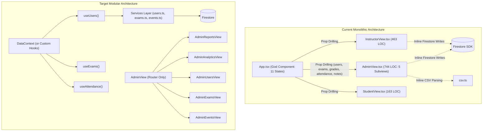

# Code Quality and Complexity Audit: apps/main

**Date:** November 2026  
**Auditor:** Code Quality and Complexity Auditor (`@complexity`)  
**Target Scope:** `apps/main` (Views, Components, Contexts, Utilities)  
**Status:** Complete  

---

## 1. Executive Summary

A comprehensive code quality, complexity, and maintainability audit was conducted across the `apps/main` React application. The audit focused on identifying code smells, cyclomatic complexity, deeply nested logic, god components, duplicated cross-view logic, redundant state/effects, performance bottlenecks, and dead code.

### 1.1 Key Metrics & Overview

| Metric | Measurement / Value | Assessment |
|---|---|---|
| **Total Source Files Audited** | 47 files (`.ts`, `.tsx`) | Medium-sized frontend application |
| **Total TypeScript/React LOC** | ~5,500 lines of code | Manageable overall volume |
| **Top 5 Largest Modules** | `AdminView.tsx` (744 lines, 54KB)<br>`BulletinEditorModal.tsx` (696 lines, 37KB)<br>`AuthContext.tsx` (542 lines, 22KB)<br>`InstructorView.tsx` (463 lines, 32KB)<br>`App.tsx` (377 lines, 16KB) | **Critical Complexity Hotspots** (Account for >50% of application code) |
| **Architectural Smells** | God Components, Prop Drilling, Presentation-Database Coupling | High Severity |
| **Dead Code Identified** | Unused memos, unused helper functions, orphan state | Medium Severity |
| **Functional / Rendering Bugs** | Misplaced modal rendering (`BulletinEditorModal` in `AdminView`) | **High / Critical UI Bug** |
| **Performance Bottlenecks** | N+1 sequential Firestore writes in attendance saves | High Performance Impact |

---

## 2. Critical Findings & Code Smells Matrix

| ID | Module / File | Severity | Smell / Category | Summary |
|---|---|---|---|---|
| **CQ-01** | `src/views/AdminView.tsx` (L301–L308) | **Critical** | **Functional Bug / Misplaced Component** | `BulletinEditorModal` is nested inside `selectedAttendanceEvent ? (...)` branch. When no attendance event is selected (standard state), opening the modal is impossible. |
| **CQ-02** | `src/views/AdminView.tsx` | **High** | **God View / Extreme Cyclomatic Complexity** | 744 lines containing 5 full sub-views, inline CRUD operations, direct Firebase Firestore mutations, ad-hoc aggregation loops, and navigation state. |
| **CQ-03** | `src/components/bulletin/BulletinEditorModal.tsx` | **High** | **Violations of SRP / Brittle DOM Manipulation** | 696 lines combining a custom WYSIWYG editor using manual DOM range selection (`selection.getRangeAt(0)`), Firebase Storage image uploading, link chip builder, and live preview. |
| **CQ-04** | `src/context/AuthContext.tsx` | **High** | **Reinvented Cryptography & Bloated Context** | 80 lines of manual bitwise JavaScript SHA-256 implementation instead of native Web Crypto API (`crypto.subtle`), combined with multi-role login flows and raw `localStorage` tokens. |
| **CQ-05** | `src/App.tsx` | **High** | **God Component / Severe Prop Drilling** | Root component manages 10+ unrelated states (`usersList`, `exams`, `grades`, `attendance`, `notes`, `eventsList`, `siteSettings`, UI alerts) and drills them 2–3 levels down. Contains side-effects inside database subscriptions. |
| **CQ-06** | `src/components/events/AttendanceReportTable.tsx` (L84–L94) | **High** | **N+1 Sequential Network Requests** | Loops over student attendance with sequential `await setDoc(...)` inside a `for` loop instead of a atomic `writeBatch`, causing heavy latency and network blocking. |
| **CQ-07** | Multiple Files (`AdminView`, `InstructorView`, `StudentView`, etc.) | **Medium** | **Entity Identity Ambiguity** | Fallback triple-chains (`student.id \|\| student.phone \|\| student.firestoreId`) repeated across dozens of components due to inconsistent data modeling. |
| **CQ-08** | Multiple Files (`AdminView`, `InstructorView`, `StudentView`, `csv.ts`) | **Medium** | **Logic Duplication / Bypassed Utilities** | Grade total reduction logic (`Object.values(g.scores).reduce(...)`) re-implemented 5 times inline, completely bypassing the exported `calculateTotalScore` utility in `src/utils/exams.ts`. |
| **CQ-09** | `src/views/StudentView.tsx` (L43) | **Low** | **Dead Code / Unused Memo** | `_attendanceEvents` is memoized and computed on every render but never referenced or rendered. |
| **CQ-10** | `src/components/users/StudentProfileModal.tsx` (L92) | **Medium** | **Props Mutation Anti-Pattern** | Directly mutates the passed `student` prop object (`student.tags = updatedTags;`) violating React's immutability principles. |

---

## 3. Deep-Dive Codebase Analysis

### 3.1 `AdminView.tsx` (744 Lines, 54,078 Bytes)

#### A. Monolithic God View & Responsibility Creep
`AdminView` is by far the largest single file in the repository. It violates the Single Responsibility Principle by hosting five distinct sub-views (`reports`, `analytics`, `users`, `exams`, `events`) within one component.
- **Lines 108–173**: Heavy mathematical calculations and multi-level data reduction executed in `useMemo` hooks:
  - School distribution tallying (`reduce`).
  - Attendance rate calculations across all historical events and all students.
  - Group averages by department with nested loops across students and exams.
- **Lines 177–209**: Direct CSV file parsing and batch writing to Firestore.
- **Lines 232–255**: Inline administrative configuration setters modifying Firestore root configuration directly.

#### B. Critical UI Rendering Bug (Misplaced Modal)
In lines 292–310:
```tsx
{selectedAttendanceEvent ? (
    <React.Suspense fallback={<div className="...">טוען נתוני נוכחות...</div>}>
        <AttendanceReportTable
            event={selectedAttendanceEvent}
            students={filteredStudents}
            attendance={attendance}
            onClose={() => setSelectedAttendanceEvent(null)}
            showToast={showToast}
        />
        {isBulletinModalOpen && (
            <BulletinEditorModal
                isOpen={isBulletinModalOpen}
                onClose={() => setIsBulletinModalOpen(false)}
                showToast={showToast}
                currentUserName={profile.name || profile.fullName}
            />
        )}
    </React.Suspense>
) : (
    <div className="bg-white rounded-[24px] ...">
    ...
```
**Impact:** `BulletinEditorModal` was accidentally placed inside the `selectedAttendanceEvent ?` conditional branch. Unless an admin has navigated to "לוח אירועים" AND opened a specific attendance sheet for a meeting, clicking the prominent "לוח מודעות" button in the header (line 220) will update state (`setIsBulletinModalOpen(true)`), but **the modal will never render!**

#### C. Direct Presentation-Database Coupling
Instead of delegating mutations to service functions or custom hooks, `AdminView` imports `setDoc`, `deleteDoc`, and `writeBatch` directly from `firebase/firestore`. Event deletion, exam visibility toggles, and user deletions are handled inline within JSX `onClick` props.

---

### 3.2 `BulletinEditorModal.tsx` (696 Lines, 36,914 Bytes)

#### A. Multi-Domain Responsibility Overload
This modal attempts to be:
1. A rich-text WYSIWYG editor.
2. A binary image file validator and Firebase Cloud Storage uploader.
3. An image gallery manager with inline caption editors.
4. A dynamic URL link chip builder.
5. A live dual-tab previewer (`BulletinBoardBanner`).
6. A Firestore synchronization engine.

#### B. Brittle DOM Range Manipulation
Lines 112–170 manipulate DOM nodes directly using `window.getSelection()`, `range.extractContents()`, `document.createElement('span')`, and `range.insertNode(wrapper)`:
```tsx
const range = selection.getRangeAt(0);
const selectedText = range.extractContents();
const wrapper = document.createElement('span');
wrapper.style.fontSize = '20px';
wrapper.appendChild(selectedText);
range.insertNode(wrapper);
setHtmlContent(editorRef.current.innerHTML);
```
**Risks:**
- Prone to browser inconsistencies, especially in mobile Safari and Android Chrome where virtual keyboard interactions break active selection ranges.
- Bypasses React's virtual DOM reconciliation, causing potential desync between `editorRef.current.innerHTML` and React state.
- Cleaning or undoing formatting is error-prone and can generate invalid nested markup.

---

### 3.3 `AuthContext.tsx` (542 Lines, 21,818 Bytes)

#### A. Reinvented SHA-256 Cryptographic Algorithm
Lines 29–106 define an 80-line manual implementation of SHA-256 (`computeSHA256`) with custom bitwise rotations and prime constants.
- **Why this is bad practice:** All modern browsers support the standardized, hardware-accelerated Web Crypto API:
  ```ts
  const digestBuffer = await crypto.subtle.digest('SHA-256', new TextEncoder().encode(input));
  ```
- The manual implementation increases bundle size, is harder to audit, and carries unnecessary maintenance overhead.

#### B. Context Responsibility Bloat
`AuthContext` manages:
- Firebase anonymous session handling (`onAuthStateChanged`, `signInAnonymously`).
- Student phone/name validation and cold-lookup Firestore queries.
- Staff SMS OTP orchestration (`recaptchaVerifier`, `signInWithPhoneNumber`, `confirmationResult`).
- Staff static passcode verification and legacy pseudo-token storage (`btoa`).
- Client-side role escalation prevention guards.
- Session expiration timer tracking.

---

### 3.4 `InstructorView.tsx` (463 Lines, 31,979 Bytes)

#### A. Conflicting Early-Return Architecture
`InstructorView` utilizes multiple full-component early returns:
1. **Lines 163–241**: `if (selectedStudent) { return ( ... ); }`
   - Re-implements an entire grade entry form and personal notes editor inline (80 lines of JSX), bypassing the existing standalone `GradeEntryModal` and `StudentProfileModal` components.
2. **Lines 243–259**: `if (selectedMeeting) { return ( ... ); }`
   - Replaces the entire screen with `AttendanceReportTable`.
3. **Lines 437–450**: Also conditionally renders `StudentProfileModal` when `selectedStudentForModal` is set.
**Smell:** These conflicting sub-flows make state transitions difficult to follow and create severe code duplication between the inline grade editor and `GradeEntryModal`.

#### B. Redundant Authentication Checks
Lines 134–136 and 150–152 repeatedly invoke:
```tsx
if (!auth.currentUser) {
    await signInAnonymously(auth);
}
```
This check should be centralized in an API/auth client utility rather than scattered through view handlers.

---

### 3.5 `App.tsx` (377 Lines, 16,249 Bytes)

#### A. God Component State Container & Prop Drilling
`AppContent` maintains 11 separate state variables:
- `usersList`, `exams`, `grades`, `attendance`, `notes`, `siteSettings`, `eventsList`, `toast`, `modal`, `view`.
Every view component (`AdminView`, `InstructorView`, `StudentView`) receives nearly all of these states as raw props. Changes to any state trigger re-renders down the tree.

#### B. Impure Side-Effects Inside Snapshot Listeners
Lines 123–144: Inside the Firestore `onSnapshot` listener for the `events` collection, if the collection is empty, a write batch is executed to seed default meetings.
```tsx
const unsubEvents = onSnapshot(collection(...), async (s) => {
    ...
    if (s.empty && profile.role !== 'student') {
        const batch = writeBatch(db);
        // Seeds default meetings into Firestore...
        await batch.commit();
    }
});
```
**Smell:** Seeding database records inside a real-time reactive subscription callback can trigger race conditions, infinite loops, or duplicate writes when multiple staff members load the app concurrently. Seeding should be an explicit administrative command or migration step.

#### C. Reactive Loops in Admin Profile Sync Effect
Lines 154–175:
```tsx
useEffect(() => {
    if (!user || !profile || profile.role !== 'admin' || !profile.phone) return;
    const exists = usersList.some((u) => u.phone === phone || u.id === phone);
    if (!exists) {
        setDoc(...);
    }
}, [user, profile, usersList]);
```
This effect depends on `usersList`. When `setDoc` executes, the Firestore snapshot listener updates `usersList`, causing the effect to re-evaluate. While the `!exists` guard prevents an infinite loop, this design is fragile and reactive to unrelated user roster updates.

---

### 3.6 Performance Hotspot: `AttendanceReportTable.tsx` (L84–L94)

In `handleSaveAll`:
```tsx
const studentIds = Object.keys(tempAtt);
for (const sId of studentIds) {
    const status = tempAtt[sId];
    if (status !== undefined) {
        await setDoc(
            doc(db, 'artifacts', appId, 'public', 'data', 'attendance', sId),
            { [event.id]: status },
            { merge: true }
        );
    }
}
```
**Issue:** If a course cohort contains 80 students, clicking "שמור" performs **80 consecutive asynchronous network round trips**. In cellular or high-latency environments, this takes several seconds and risks partial writes if the user navigates away mid-loop.
**Remedy:** Use Firestore `writeBatch` (which batches up to 500 operations into a single atomic atomic network payload), exactly as is done in `AdminView.handleImportCSV`.

---

## 4. Cross-Cutting Code Smells & Patterns

### 4.1 The "Entity Identity Ambiguity" Smell
Throughout the codebase, entities—specifically students—lack a single normalized identifier. Across views, tables, and modals, the following pattern appears over 35 times:
```tsx
const studentId = student.id || student.phone || student.firestoreId || '';
const gradeKey = `${studentId}_${exam.id}`;
const att = attendance[studentId] || attendance[student.phone] || attendance[student.firestoreId];
```
In `App.tsx` (L109), documents are mapped with three identical ID fields:
```tsx
setUsersList(s.docs.map((d) => ({
    id: d.id,
    phone: d.id,
    firestoreId: d.id,
    ...d.data()
})));
```
**Impact:** Triple-fallback chains clutter the code, make types confusing (`id` vs `phone` vs `firestoreId`), and invite subtle lookup bugs when querying nested maps (`attendance`, `grades`, `notes`).

### 4.2 Duplicated Score Calculation Logic
In `src/utils/exams.ts`, the following utility is defined:
```ts
export const calculateTotalScore = (scores: Record<string, number> | undefined): number => {
    if (!scores) return 0;
    return Object.values(scores).reduce((sum, val) => sum + (Number(val) || 0), 0);
};
```
However, almost every view reinvents this logic inline:
- **`AdminView.tsx` (L163 & L663):**
  `Object.values(gData.scores as Record<string, unknown>).reduce((a: number, b: unknown) => a + (parseInt(String(b || 0), 10) || 0), 0)`
- **`InstructorView.tsx` (L357):**
  `Object.values(g.scores as Record<string, unknown>).reduce((acc: number, val: unknown) => acc + (Number(val) || 0), 0)`
- **`StudentView.tsx` (L55):**
  `Object.values(g.scores).reduce((a: number, b: number) => (Number(a) || 0) + (Number(b) || 0), 0)`
- **`csv.ts` (L127):**
  `Object.values(g.scores || {}).reduce((a: any, b: any) => (parseInt(a) || 0) + (parseInt(b) || 0), 0)`

### 4.3 Dead Code Inventory
1. **`StudentView.tsx` (L43–L47):**
   ```tsx
   const _attendanceEvents = useMemo(() => {
       return (eventsList || [])
           .filter((e: CourseEvent) => e.type !== 'יום חשיפה')
           .sort((a: CourseEvent, b: CourseEvent) => new Date(a.date).getTime() - new Date(b.date).getTime());
   }, [eventsList]);
   ```
   Computed on every render, never used.
2. **`attendance.ts` (L45–L68):**
   `calculateGroupAttendanceStats` is completely unreferenced across the entire codebase. `AdminView` wrote its own inline calculation instead.

### 4.4 Direct Mutation of Props
In `StudentProfileModal.tsx` (L91–L92):
```tsx
await setDoc(doc(db, 'artifacts', appId, 'public', 'data', 'users', studentId), { tags: updatedTags }, { merge: true });
student.tags = updatedTags;
```
Direct mutation of the `student` object prop can cause stale state bugs in parent components and bypasses React state change detection.

---

## 5. Architectural Modularization Strategy

### 5.1 Architecture Transformation Diagram



### 5.2 Specific Modularization Blueprints

#### 1. Refactoring `AdminView.tsx`
Decompose `AdminView` into five dedicated subview components located in `src/views/admin/`:
- `src/views/admin/AdminReportsView.tsx`
- `src/views/admin/AdminAnalyticsView.tsx` (using a dedicated `useAnalyticsStats(students, attendance, grades, exams)` hook)
- `src/views/admin/AdminUsersView.tsx`
- `src/views/admin/AdminExamsView.tsx`
- `src/views/admin/AdminEventsView.tsx`

`AdminView.tsx` reduces from 744 lines to **~90 lines**, acting solely as a sub-view router and header container.

#### 2. Resolving the `BulletinEditorModal` Bug and Decomposition
- **Immediate Bugfix:** Move `<BulletinEditorModal />` outside the `selectedAttendanceEvent ?` ternary and place it inside the root modal container suspense block (lines 682–730).
- **Component Decomposition:**
  - `src/components/bulletin/editor/BulletinToolbar.tsx` (font size, color controls)
  - `src/components/bulletin/editor/BulletinImageUploader.tsx` (file input & upload progress)
  - `src/components/bulletin/editor/BulletinLinkChipsEditor.tsx` (chips list and input)
  - `src/components/bulletin/hooks/useBulletinEditor.ts` (storage & firestore operations)

#### 3. Refactoring `AuthContext.tsx`
- Replace `computeSHA256` with browser-native Web Crypto API:
  ```ts
  export const hashPasscode = async (passcode: string): Promise<string> => {
      const msgBuffer = new TextEncoder().encode(passcode.trim());
      const hashBuffer = await crypto.subtle.digest('SHA-256', msgBuffer);
      const hashArray = Array.from(new Uint8Array(hashBuffer));
      return hashArray.map(b => b.toString(16).padStart(2, '0')).join('');
  };
  ```
- Split auth providers into cohesive sub-services:
  - `src/services/auth/studentAuth.ts`
  - `src/services/auth/staffOtpAuth.ts`
  - `src/services/auth/staffPasscodeAuth.ts`

#### 4. Introducing a Unified Data Access Service Layer
Instead of importing Firestore SDK functions inside components, create clean services:
- `src/services/attendanceService.ts`: Includes `saveAttendanceBatch(eventId, records)` using `writeBatch`.
- `src/services/examService.ts`: CRUD for exams and grade entry.
- `src/services/userService.ts`: User updates and tag toggles.

---

## 6. Actionable Implementation Plan

### Phase 1: Immediate Quick-Wins (High Impact, Low Risk)
1. **Fix `BulletinEditorModal` in `AdminView`**: Relocate modal rendering from the attendance branch to the root suspense container.
2. **Optimize Attendance Saves**: Convert `AttendanceReportTable.handleSaveAll` from sequential `setDoc` calls in a `for` loop to a single atomic `writeBatch`.
3. **Clean Dead Code**: Delete unused `_attendanceEvents` in `StudentView.tsx`.
4. **Standardize Score Calculations**: Replace all inline `scores.reduce` snippets with `calculateTotalScore(scores)` from `src/utils/exams.ts`.
5. **Fix Prop Mutation in `StudentProfileModal`**: Replace `student.tags = updatedTags` with parent callback notification `onUpdateStudentTags(studentId, updatedTags)`.

### Phase 2: Modularization & Subview Extraction
1. Extract `AdminAnalyticsView`, `AdminReportsView`, `AdminUsersView`, `AdminExamsView`, and `AdminEventsView` from `AdminView.tsx`.
2. Extract the inline grade and note editing forms in `InstructorView.tsx` to reuse `GradeEntryModal` and `StudentProfileModal`.
3. Replace the 80-line manual SHA-256 implementation in `AuthContext.tsx` with standard `crypto.subtle`.

### Phase 3: Architecture Modernization
1. Introduce custom hooks (`useUsers`, `useExams`, `useAttendance`) to relieve `App.tsx` from prop-drilling 11 states.
2. Normalize user identification across the schema so `student.id` is the single source of truth, removing defensive triple fallbacks throughout the application.
