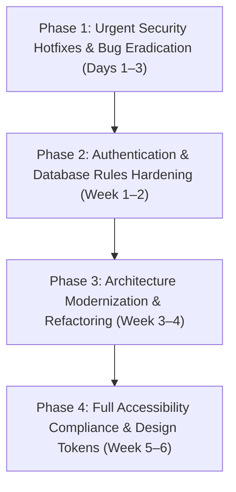

# Executive Audit Synthesis & Health Scorecard: apps/main

**Target Application:** `apps/main` (Leadership Course Management Portal & Field Game)  
**Synthesis Date:** November 12, 2026  
**Lead Synthesizer & Verifier:** Verification Agent (`@verifier`)  
**Auditing Swarm Members:**
- Security Auditor (`@security`) — [audit-security.md](file:///apps/main/docs/audit-security.md)
- Code Quality & Complexity Auditor (`@complexity`) — [audit-code-quality.md](file:///apps/main/docs/audit-code-quality.md)
- Idiomatic Practices & Architecture Auditor (`@conventions`) — [audit-best-practices.md](file:///apps/main/docs/audit-best-practices.md)
- Accessibility Auditor (`@a11y`) — [audit-accessibility.md](file:///apps/main/docs/audit-accessibility.md)

---

## 1. Executive Summary & Composite Health Score

A comprehensive, multi-dimensional codebase audit was performed across the `apps/main` frontend web application. The application delivers critical day-to-day administrative, grading, attendance, schedule tracking, and field game functionality for commanders, instructors, and cadets in the Israeli Leadership Course (קורס הנהגה).

Each audit finding was independently re-verified line-by-line against the codebase by `@verifier`. **Zero false positives or hallucinations were identified.** All documented line references, code snippets, architectural smells, and vulnerability chains are confirmed to exist directly in the active repository.

### 1.1 Overall Health Score: 47 / 100 (High Risk / Severe Technical Debt)

While the application features clean Material-inspired visual styling, rapid Vite build performance, and modern core dependencies (React 19, Tailwind CSS v4, Firebase v12), its operational reliability is critically undermined by broken backend security rules, client-side secret exposure, unhandled error boundaries, and non-compliant accessibility barriers.

```
┌────────────────────────────────────────────────────────────────────────┐
│                      COMPOSITE HEALTH SCORE: 47 / 100                  │
├────────────────────────┬─────────┬──────────────┬──────────────────────┤
│ Dimension              │ Score   │ Status       │ Primary Risk         │
├────────────────────────┼─────────┼──────────────┼──────────────────────┤
│ 1. Security & Auth     │ 25 / 100│ 🔴 Critical  │ Open DB, bundle leaks│
│ 2. Code Quality & Mod  │ 55 / 100│ 🟡 Moderate  │ 744 LOC god views, N+1│
│ 3. Architecture & PWA  │ 54 / 100│ 🟡 Moderate  │ 0 ErrorBoundary, no TS lint│
│ 4. Accessibility (a11y)│ 52 / 100│ 🟠 Non-Compl.│ 0/8 trapped dialogs  │
└────────────────────────┴─────────┴──────────────┴──────────────────────┘
```

---

## 2. Independent Verification & Hallucination Check

Every finding submitted by the specialist auditors was inspected directly against `apps/main/src`, `apps/main/firestore.rules`, `apps/main/package.json`, and configuration files:

1. **Security Findings (`audit-security.md`):**
   - **SEC-CRIT-03 & 04 (Firestore Rules):** Verified in [firestore.rules](file:///apps/main/firestore.rules#L41-L45). `isAuthenticated()` is satisfied by anonymous auth, and `isStaff`/`isAdmin` functions are defined but never used in any collection rule. Unauthenticated visitors have read/write/delete access to user profiles, grades, and system settings.
   - **SEC-CRIT-06 (.env Passcode Leak):** Verified in [apps/main/.env](file:///apps/main/.env#L9). `VITE_STAFF_PASSCODE=idanaviv100` is prefixed with `VITE_`, forcing Vite to bundle the plaintext passcode directly into the client production bundle.
   - **SEC-CRIT-05 (Stored XSS):** Verified in [BulletinEditorModal.tsx](file:///apps/main/src/components/bulletin/BulletinEditorModal.tsx#L273-L289) and [BulletinBoardBanner.tsx](file:///apps/main/src/components/bulletin/BulletinBoardBanner.tsx#L114-L119). `innerHTML` is written to Firestore without sanitization and rendered via `dangerouslySetInnerHTML`.

2. **Code Quality & Complexity (`audit-code-quality.md`):**
   - **CQ-01 (Functional UI Bug):** Verified in [AdminView.tsx](file:///apps/main/src/views/AdminView.tsx#L301-L308). `BulletinEditorModal` is erroneously placed inside `{selectedAttendanceEvent ? (...) : (...)}`. When no attendance event is selected (the normal state), clicking the prominent "לוח מודעות" header button updates state but the modal cannot render.
   - **CQ-06 (N+1 Writes):** Verified in [AttendanceReportTable.tsx](file:///apps/main/src/components/events/AttendanceReportTable.tsx#L84-L94). Saves attendance with sequential `await setDoc(...)` inside a `for` loop instead of an atomic `writeBatch`.
   - **CQ-10 (Prop Mutation):** Verified in [StudentProfileModal.tsx](file:///apps/main/src/components/users/StudentProfileModal.tsx#L92). Mutates `student.tags = updatedTags` directly.

3. **Conventions & Architecture (`audit-best-practices.md`):**
   - **BP-TS-01 (ESLint Blindspot):** Verified in [eslint.config.js](file:///apps/main/eslint.config.js#L10). Targets only `files: ['**/*.{js,jsx}']`, completely bypassing all `.ts` and `.tsx` source files. `typescript-eslint` is absent.
   - **BP-REACT-01 (Zero Error Boundaries):** Confirmed across the entire tree; any runtime exception or lazy chunk network error causes a white screen of death.
   - **BP-PWA-01 (Defective PWA):** Verified in [public/sw.js](file:///apps/main/public/sw.js#L3-L10). Pre-caches only 6 static root files; misses all Vite hashed `/assets/index-[hash].js` bundles, breaking offline boot.
   - **BP-TS-04 (Bogus TS Version):** Verified in [package.json](file:///apps/main/package.json#L37). Specifies `"typescript": "^7.0.2"`.

4. **Accessibility (`audit-accessibility.md`):**
   - **A11Y-04 & 05 (Modal Focus Traps):** Verified in [Modal.tsx](file:///apps/main/src/components/ui/Modal.tsx#L14-L20). Zero focus containment, and Escape key is explicitly blocked if `modal.isConfirm` is true.
   - **A11Y-15 & 18 (Un-focusable Elements):** Verified in [AdminView.tsx](file:///apps/main/src/views/AdminView.tsx#L629) (`<tr onClick>`) and [InstructorView.tsx](file:///apps/main/src/views/InstructorView.tsx#L309) (`<div onClick>` accordion header) without keyboard focus or roles.
   - **A11Y-26 & 27 (Game Assistive Lockdown):** Verified in [GameView.tsx](file:///apps/main/src/views/game/GameView.tsx#L39-L42) (`overflow: hidden`, `touchAction: manipulation`) and [LandscapeGuard.tsx](file:///apps/main/src/views/game/components/LandscapeGuard.tsx#L28-L55) (portrait blocking overlay).

---

## 3. Top Critical Issues Requiring Immediate Action

The following 8 items represent the highest-risk vulnerabilities and defects across all reports:

| Rank | ID | Domain | File Location | Defect / Vulnerability Summary | Operational Impact |
|:---:|:---:|:---:|:---|:---|:---|
| **1** | **SEC-CRIT-03 / 04** | Security | `firestore.rules:41-65` | Ineffective Firestore rules relying solely on `isAuthenticated()`. `isStaff`/`isAdmin` never invoked. | Any anonymous web visitor can read, overwrite, or delete all student/staff PII, grades, and tracking notes. |
| **2** | **SEC-CRIT-06 / 02** | Security | `.env:9`, `AuthContext.tsx:118-139` | Plaintext staff passcode bundled into Vite bundle; base64 staffToken forged trivially to grant Admin in `App.tsx`. | Instant elevation of privileges to Admin by anyone viewing browser DevTools. |
| **3** | **SEC-CRIT-05** | Security | `BulletinBoardBanner.tsx:117`, `BulletinEditorModal.tsx:273` | Unsanitized `innerHTML` rendered directly with `dangerouslySetInnerHTML` alongside open Firestore writes. | Stored Cross-Site Scripting (XSS) executing arbitrary scripts on staff and student devices. |
| **4** | **CQ-01** | Quality | `AdminView.tsx:301-308` | `BulletinEditorModal` placed inside `{selectedAttendanceEvent ? (...) : (...)}`. | Critical UI bug: Bulletin Board modal cannot be opened from the Admin View under normal conditions. |
| **5** | **BP-REACT-01** | Architecture | Root App Tree (`App.tsx`, `main.tsx`) | Complete absence of React `<ErrorBoundary>` wrappers. | Any unhandled JavaScript error or dropped lazy-chunk network request results in a permanent blank screen (WSOD). |
| **6** | **BP-TS-01** | Architecture | `eslint.config.js:10` | ESLint configuration explicitly filters `files: ['**/*.{js,jsx}']`. | Linting is non-functional: 0% of the TypeScript/TSX codebase is checked by CI/CD or local `npm run lint`. |
| **7** | **A11Y-04 / 05** | a11y | `Modal.tsx`, `UserFormModal.tsx`, `EventBuilderModal.tsx` | All 8 modals lack Tab focus trapping, auto-focus, and focus restoration; confirm modals block Escape. | Severe accessibility failure: screen reader and keyboard-only users become disoriented or trapped. |
| **8** | **BP-PWA-01 / 02** | Architecture | `public/sw.js:3-10` | Hand-rolled service worker precaches root files only; omits Vite hashed JS/CSS production chunks. | Offline PWA mode completely fails to boot when connectivity is lost in the field. |

---

## 4. Prioritized Unified Remediation Roadmap

To ensure engineering efficiency, remediations are sequenced into 4 distinct phases balancing security posture, stability, maintainability, and user experience.



### Phase 1: Urgent Security Hotfixes & Bug Eradication (Days 1–3)
> **Goal:** Close zero-day attack vectors, fix broken core UI functionality, and establish basic resilience.

- [ ] **Fix AdminView Modal Nesting (CQ-01):** Relocate `<BulletinEditorModal>` outside the `selectedAttendanceEvent ?` ternary in `AdminView.tsx` so it renders at root level.
- [ ] **Mitigate Stored XSS (SEC-CRIT-05):** Install `dompurify` and `@types/dompurify`. Sanitize `htmlContent` both before writing in `BulletinEditorModal.tsx` and before rendering in `BulletinBoardBanner.tsx`:
  ```tsx
  <div dangerouslySetInnerHTML={{ __html: DOMPurify.sanitize(boardData.htmlContent) }} />
  ```
- [ ] **Remove Plaintext Passcode from Client Bundle (SEC-CRIT-06):** Delete `VITE_STAFF_PASSCODE` from `.env` and remove references from `AuthContext.tsx`. Passcode verification must not occur against bundled plaintext.
- [ ] **Introduce Root & View Error Boundaries (BP-REACT-01):** Implement a robust `ErrorBoundary` component with Hebrew fallback UI, reload button, and error telemetry. Wrap `AppContent` and all lazy-loaded view components.
- [ ] **Activate TypeScript Linting (BP-TS-01):** Update `eslint.config.js` to include `typescript-eslint` and target `**/*.{ts,tsx}`. Fix package.json TS version from `"^7.0.2"` to `"~5.7.3"`.

### Phase 2: Authentication & Database Rules Hardening (Week 1–2)
> **Goal:** Establish cryptographically verified identity, eliminate client-side role forgery, and lock down Firestore.

- [ ] **Deploy Hardened Firestore Security Rules (SEC-CRIT-03, SEC-CRIT-04, SEC-HIGH-03, SEC-HIGH-04):**
  - Implement the replacement rules provided in `audit-security.md`.
  - Disallow anonymous write access to `users`, `exams`, `grades`, `attendance`, `bulletin_boards`, and `config`.
  - Enforce role-based access using Firebase Custom Claims (`request.auth.token.role`) or verified user documents.
- [ ] **Migrate to Server-Verified Staff & Student Authentication (SEC-CRIT-01, SEC-CRIT-02):**
  - Deprecate client-side `btoa` staff tokens and anonymous student name matching.
  - Implement a Firebase Cloud Function (`verifyStaffPasscode` / `loginStudentOtp`) that validates credentials and issues custom Firebase Auth tokens with signed claims.
- [ ] **Optimize Attendance Network Saves (CQ-06):** Refactor `AttendanceReportTable.handleSaveAll` to use `writeBatch(db)` instead of sequential `await setDoc` in a `for` loop.
- [ ] **Universal Modal Focus Trap Hook (A11Y-04, A11Y-05):** Build and deploy a reusable `useA11yDialog` hook implementing focus trapping, initial focus, focus return, and unrestricted Escape listener.

### Phase 3: Architecture Modernization & Refactoring (Week 3–4)
> **Goal:** Eliminate god components, decouple database logic, and fix PWA offline resilience.

- [ ] **Modularize `AdminView.tsx` (CQ-02):** Deconstruct `AdminView` into discrete sub-view components (`AdminReportsView`, `AdminAnalyticsView`, `AdminUsersView`, `AdminExamsView`, `AdminEventsView`) backed by custom hooks (`useAdminStats`, `useAdminEvents`).
- [ ] **Refactor `BulletinEditorModal.tsx` (CQ-03):** Replace manual DOM range manipulation (`selection.getRangeAt(0)`) with a standard headless editor (e.g. Tiptap) and split into separate photo gallery and editor subcomponents.
- [ ] **Adopt Modern PWA Tooling (BP-PWA-01, BP-PWA-02):** Replace `public/sw.js` with `vite-plugin-pwa` (Workbox) to automatically precache Vite's hashed production chunks and configure runtime caching for avatars and fonts.
- [ ] **Standardize Entity Identity & Score Calculations (CQ-07, CQ-08):** Normalize user objects to use `id` consistently; enforce the exported `calculateTotalScore` utility across all views instead of inline `reduce` loops.
- [ ] **Eliminate React Prop Mutation (CQ-10):** Fix `StudentProfileModal.tsx:92` to update state immutably rather than mutating `student.tags` directly.

### Phase 4: Full Accessibility Compliance & Design Tokens (Week 5–6)
> **Goal:** Achieve legal IS 5568 / WCAG 2.1 AA compliance, optimize mobile usability, and clean up styles.

- [ ] **Keyboard Accessibility for Custom Controls (A11Y-15, A11Y-18):**
  - Convert `InstructorView` accordion headers from plain `<div onClick>` to `<button>` with `aria-expanded`.
  - Add `tabIndex={0}`, `role="button"`, and keyboard `Enter`/`Space` handlers to interactive table rows in `AdminView`.
- [ ] **Form Label Associations (A11Y-06, A11Y-07, A11Y-08):** Connect all form `<label>` elements to inputs using matching `htmlFor` and `id` attributes in `EventBuilderModal`, `ExamBuilderModal`, `GradeEntryModal`, and `UserFormModal`.
- [ ] **Accessible Field Game Controls (A11Y-26, A11Y-27, A11Y-29):**
  - Provide a prominent manual station-code text input in `QrScannerModal` for users unable to scan QR codes with a camera.
  - Remove intrusive `overflow: hidden` and touch locks from `GameView.tsx`.
  - Soften orientation guard in `LandscapeGuard.tsx` to allow portrait mode with responsive reflow.
- [ ] **Tailwind v4 Token Consolidation (BP-CSS-01, BP-CSS-02):** Replace 629+ arbitrary hardcoded `#hex` utility classes with semantic design tokens defined in `@theme` inside `index.css`. Add global `:focus-visible` ring indicators.

---

## 5. Master Findings Cross-Reference Matrix

| Category | Report Source | Critical | High | Medium | Low | Total Violations |
|:---|:---|:---:|:---:|:---:|:---:|:---:|
| **Security & Access Control** | [audit-security.md](file:///apps/main/docs/audit-security.md) | 6 | 4 | 3 | 2 | **15** |
| **Code Quality & Complexity** | [audit-code-quality.md](file:///apps/main/docs/audit-code-quality.md) | 1 | 5 | 3 | 1 | **10** |
| **Idiomatic Best Practices** | [audit-best-practices.md](file:///apps/main/docs/audit-best-practices.md) | 1 | 4 | 4 | 2 | **11** |
| **Accessibility (WCAG 2.1 AA)**| [audit-accessibility.md](file:///apps/main/docs/audit-accessibility.md) | 6 | 12 | 11 | 5 | **34** |
| **Total Cross-System Findings** | | **14** | **25** | **21** | **10** | **70** |

---

## 6. Conclusion & Recommendation

The `apps/main` codebase possesses a clean user interface and modern dependencies, but requires immediate structural intervention. **Phase 1 actions (closing XSS, removing plaintext secrets, fixing the AdminView modal bug, adding ErrorBoundary, and fixing ESLint) should be executed immediately before the next student deployment.**

Phases 2 through 4 will transition the application into a secure, robust, and accessible enterprise-grade platform.
